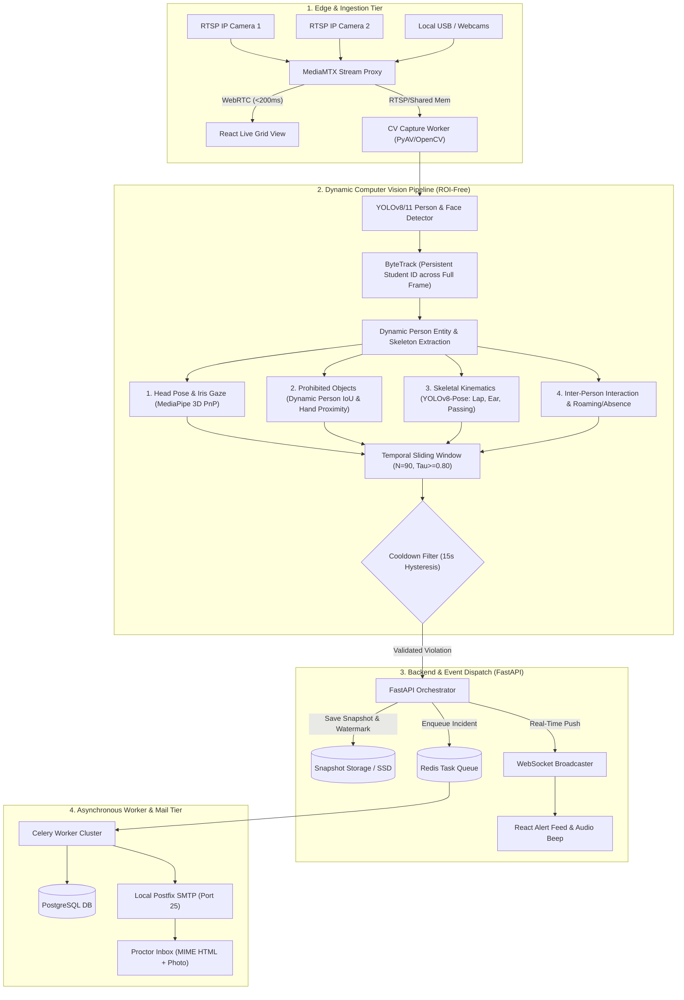
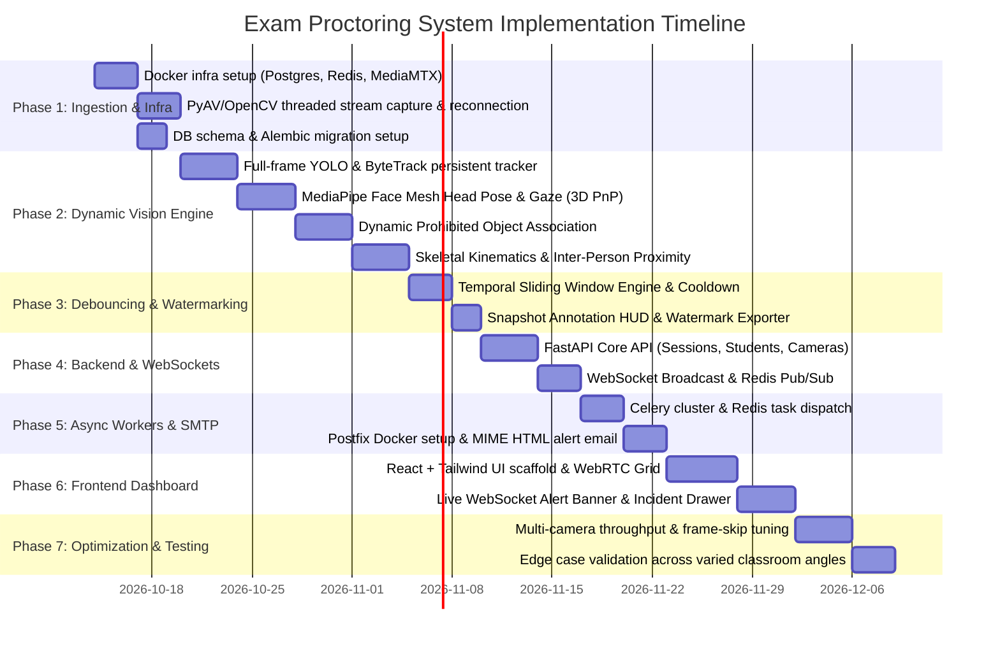

# Automated AI-Powered Exam Monitoring & Proctoring System
## Comprehensive Implementation Plan & Engineering Roadmap (Dynamic / ROI-Free Architecture)

---

## 1. Project Overview & Core Architectural Shift

The objective of this project is to construct a production-ready, edge-capable, multi-camera exam proctoring and surveillance system. 

### Why Static Desk ROIs Are Eliminated
In traditional proctoring prototypes, systems rely on hardcoded desk polygon coordinates (ROIs). **This approach fails in real-world deployments**:
- Classrooms have widely differing layouts (tiered lecture halls, straight rows, paired seating, diagonal clusters).
- Cameras may be placed at varying heights and angles (front, rear, ceiling, oblique corners) or repositioned between exams.
- Pre-calibrating static polygon coordinates for dozens of desks per room is unmaintainable and breaks if a camera is nudged even slightly.

**The Solution: 100% Dynamic, Ego-Centric & Relative Spatial Tracking**:
The system operates **free of static ROIs or fixed desk coordinates**. Every student is tracked dynamically as an autonomous person entity anywhere in the camera's field of view. Prohibited objects, hand kinematics, gaze vectors, and multi-person interactions are computed using **ego-centric facial geometry, skeletal keypoints relative to the student's body, and dynamic inter-person proximity metrics**.

---

## 2. High-Level Architecture & End-to-End Pipeline



---

## 3. Recommended Codebase Directory Structure

```plaintext
facial_vision/
├── docker/
│   ├── docker-compose.yml              # PostgreSQL, Redis, MediaMTX, Postfix/Mailpit
│   ├── Dockerfile.backend              # FastAPI app container
│   ├── Dockerfile.worker               # Celery worker container
│   ├── Dockerfile.vision               # GPU-accelerated CV inference worker
│   └── postfix/
│       ├── main.cf                     # Postfix MTA configuration
│       └── master.cf
├── services/
│   ├── common/
│   │   ├── config.py                   # Pydantic BaseSettings & env configs
│   │   ├── database.py                 # SQLAlchemy async engine & sessionmaker
│   │   └── models.py                   # SQLAlchemy ORM models (Students, Sessions, Incidents)
│   ├── ingestion/
│   │   ├── mediamtx.yml                # MediaMTX RTSP-to-WebRTC bridge config
│   │   └── stream_reader.py            # PyAV/OpenCV threaded stream capture with auto-reconnect
│   ├── vision/
│   │   ├── detector.py                 # Full-frame person & face detection (YOLOv8)
│   │   ├── tracker.py                  # ByteTrack persistent tracking & Kalman extrapolation
│   │   ├── modules/
│   │   │   ├── head_pose.py            # MediaPipe Face Mesh Euler angles & Iris gaze
│   │   │   ├── object_detector.py      # Dynamic IoU/proximity prohibited object detector
│   │   │   ├── pose_estimator.py       # YOLOv8-Pose skeletal kinematics (lap, ear, reaching)
│   │   │   └── interaction_detector.py # Inter-person proximity, collaboration & roaming/absence
│   │   ├── debouncer.py                # Rolling temporal window & hysteresis cooldown filter
│   │   ├── annotator.py                # HUD telemetry, watermark, forensic snapshot exporter
│   │   └── pipeline.py                 # Unified multi-camera frame inference loop
│   ├── backend/
│   │   ├── main.py                     # FastAPI application factory
│   │   ├── api/
│   │   │   ├── v1/
│   │   │   │   ├── auth.py             # Proctor authentication
│   │   │   │   ├── students.py         # Student roster & identity management
│   │   │   │   ├── sessions.py         # Exam sessions & camera stream mappings
│   │   │   │   ├── incidents.py        # Violation incident review, filters, pagination
│   │   │   │   └── stream.py           # WebRTC signaling / stream proxy
│   │   ├── websocket/
│   │   │   └── manager.py              # WebSocket connection manager for live alerts
│   │   └── schemas/                    # Pydantic request/response schemas
│   └── workers/
│       ├── celery_app.py               # Celery client initialization
│       ├── tasks/
│       │   ├── incident_tasks.py       # PostgreSQL persistence & snapshot indexing
│       │   └── email_tasks.py          # MIME HTML generator & SMTP dispatch to Postfix
│       └── templates/
│           └── alert_email.html        # Jinja2 template for incident email with snapshot
├── frontend/
│   ├── package.json
│   ├── vite.config.ts
│   ├── src/
│   │   ├── components/
│   │   │   ├── CameraGrid.tsx          # Multi-stream responsive video grid (WebRTC)
│   │   │   ├── VideoPlayer.tsx         # Low-latency WebRTC video canvas
│   │   │   ├── AlertBanner.tsx         # Live toast & audio chime trigger
│   │   │   ├── IncidentDrawer.tsx      # Sidebar review drawer with snapshot inspector
│   │   │   └── StudentCard.tsx         # Dynamic real-time student telemetry cards
│   │   ├── hooks/
│   │   │   ├── useWebSocket.ts         # Resilient auto-reconnecting WebSocket hook
│   │   │   └── useWebRTC.ts            # MediaMTX WebRTC consumer hook
│   │   ├── pages/
│   │   │   ├── LiveMonitoring.tsx      # Primary proctor control room
│   │   │   ├── IncidentLog.tsx         # Historical incident audit table with filters
│   │   │   └── SessionConfig.tsx       # Exam setup & camera management
│   │   └── App.tsx
├── weights/
│   ├── yolov8n.pt                      # Person & base detection
│   ├── yolov8n-pose.pt                 # Skeletal keypoints
│   └── prohibited_objects_v1.pt        # Custom trained YOLO weights
├── data/
│   └── snapshots/                      # Saved incident images
└── tests/
    ├── test_head_pose.py               # Unit tests for Euler angle math
    ├── test_debouncer.py               # Unit tests for sliding window trigger
    └── test_stream_pipeline.py         # Mock video frame stream integration test
```

---

## 4. Phase-by-Phase Implementation Plan



---

### Phase 1: Infrastructure, Stream Ingestion & Database Foundation
* **Objective**: Set up containerized infrastructure, database models, and resilient video ingestion.
* **Key Tasks**:
  1. **Dockerized Environment**:
     - Configure `docker-compose.yml` with:
       - `postgres:16-alpine` (persistence volume, initial tables)
       - `redis:7-alpine` (task queue & pub/sub broker)
       - `aler9/mediamtx` (RTSP proxy with WebRTC/WHEP enabled)
       - `axllent/mailpit` (for development email testing) + `postfix` configuration for production.
  2. **Database & ORM**:
     - Implement SQLAlchemy 2.0 async models for `Student`, `ExamSession`, `Camera`, and `ViolationIncident` (completely omitting any static desk polygon tables).
     - Configure Alembic migrations.
  3. **Resilient Stream Ingestion**:
     - Build `services/ingestion/stream_reader.py`:
       - Background thread grabbing frames using `PyAV` / `cv2.VideoCapture`.
       - Automatic backoff reconnect loop if camera drops offline.
       - Ring buffer (size 3) with latest frame discarding to guarantee zero latency accumulation.

---

### Phase 2: Core Vision Inference & Dynamic Tracking Engine (ROI-Free)
* **Objective**: Accurately detect and track students anywhere in the frame without static desk zones, extracting multi-modal behavioral cues.
* **Key Tasks**:
  1. **Full-Frame Person Detection & Persistent Tracking**:
     - Run **YOLOv8n** across the entire camera view to detect all seated or standing individuals.
     - Apply **ByteTrack** via `supervision` to assign persistent `track_id` values.
     - Maintain Kalman filter state across 30 lost frames to seamlessly survive head turns, looking down, or brief body occlusions.
  2. **Feature 1: Head Pose Estimation & Eye-Gaze (Ego-Centric)**:
     - Run **MediaPipe Face Mesh (468 3D landmarks)** directly on cropped face regions from detected persons:
       - Solve Perspective-n-Point (`cv2.solvePnP`) using a standardized 3D canonical face model.
       - Compute Euler angles (Yaw $\theta_{yaw}$, Pitch $\theta_{pitch}$, Roll $\theta_{roll}$).
       - **Orientation-Agnostic Thresholds**:
         - Looking sideways (peeking at adjacent test papers): $|\theta_{yaw}| > 30^\circ$.
         - Suspicious lap gaze: $\theta_{pitch} < -25^\circ$.
       - Relative iris displacement within eye contours detects lateral eye glance even if head is kept straight.
  3. **Feature 2: Dynamic Prohibited Object Association (No Static ROIs)**:
     - Run secondary detector (`cell_phone`, `paper_chit`, `smartwatch`, `earphone`).
     - **Dynamic Spatial Association**:
       - Associate an object with a student if its bounding box intersects ($\text{IoU} > 0$ or distance $< d_{threshold}$) with the student's dynamic bounding box or within a calibrated radius of their wrist/hand keypoints.
       - Completely eliminates the need for static desk coordinates.
  4. **Feature 3: Anomalous Body Pose & Hand Kinematics (Skeletal Keypoints)**:
     - Run **YOLOv8-Pose** (17 keypoints):
       - *Concealed Lap Hand*: Wrist keypoint $(x_w, y_w)$ located below the hip keypoint $(x_h, y_h)$ while head pitch is tilted down ($\theta_{pitch} < -20^\circ$).
       - *Reaching / Passing Items*: Wrist keypoint extending into the dynamic bounding box of an adjacent student track.
       - *Whispering / Earpiece*: Wrist keypoint within 40px of ear/nose keypoints for $\ge 2.0\text{s}$.
  5. **Feature 4: Inter-Person Interaction & Roaming/Absence**:
     - *Inter-Person Intrusion / Collaboration*: Bounding box overlap between two distinct `track_id`s ($\text{IoU} > 0.25$) or vector angle of one student's head pointed directly at another student's upper body.
     - *Roaming / Standing Up*: Aspect ratio shift of bounding box (height/width ratio drastically increasing) paired with vertical displacement velocity $> v_{threshold}$.
     - *Absence*: A tracked student entity completely disappears from the camera view for $>15\text{s}$ during an active exam session.

---

### Phase 3: Algorithmic Temporal Debouncing & Snapshot Watermarking
* **Objective**: Eliminate transient false positives (e.g. stretching, blinking, sneezing) and generate audit-grade evidence snapshots.
* **Key Tasks**:
  1. **Sliding Window Buffer (`debouncer.py`)**:
     - For each student `track_id` and violation class, maintain a fixed-size FIFO deque:
       $$W = [E_{t-N+1}, \dots, E_t], \quad N = f_{fps} \times 3.0\text{s}$$
     - Suspicion ratio $S = \frac{\sum W}{N}$. Alert triggered when $S \ge 0.80$.
  2. **Hysteresis & Cooldown Controller**:
     - Once triggered, initiate a 15-second cooldown timer for that `(track_id, violation_type)` pair.
     - Prevent repeated alerts for continuous actions while tracking cumulative violation duration.
  3. **Annotated Snapshot Generator (`annotator.py`)**:
     - Crop full camera frame and burn forensic HUD:
       - Green/Red bounding boxes around student and detected objects.
       - Euler angle telemetry overlay: `Yaw: +34° | Pitch: -12° | Conf: 0.92`.
       - Top-right banner: Timestamp (ISO 8601 UTC), Camera ID, Room No, Student Identifier.
       - Cryptographic SHA-256 hash of raw frame stored in incident record to ensure tamper-proof evidence.

---

### Phase 4: Backend API, Event Bus & Real-Time Orchestration
* **Objective**: Expose management REST APIs, orchestrate real-time WebSocket notifications, and push jobs to the queue.
* **Key Tasks**:
  1. **FastAPI Application**:
     - `/api/v1/sessions`: Create, start, stop exam sessions.
     - `/api/v1/students`: Register student rosters and reference embeddings.
     - `/api/v1/cameras`: Manage RTSP camera streams, room mappings, and status checks (zero desk coordinate configuration required).
     - `/api/v1/incidents`: Query incident history with filtering (by session, student, severity, status), review endpoints (`CONFIRMED` / `DISMISSED`).
  2. **Real-Time WebSocket Bus (`manager.py`)**:
     - Channel `/ws/alerts/{session_id}` broadcasting structured JSON events:
       ```json
       {
         "incident_id": "7b84f39e-...",
         "session_id": "a901e...",
         "track_id": 4,
         "student_id": "STU-104",
         "student_name": "John Doe",
         "camera_id": "CAM-01",
         "violation_type": "PROHIBITED_DEVICE",
         "confidence": 0.94,
         "duration_seconds": 3.4,
         "snapshot_url": "/data/snapshots/alert_STU-104_1792839.jpg",
         "thumbnail_base64": "data:image/jpeg;base64,...",
         "timestamp": "2026-10-13T13:45:10Z"
       }
       ```

---

### Phase 5: Asynchronous Worker Tier & SMTP Delivery Pipeline
* **Objective**: Decouple disk I/O and network email dispatch from the real-time vision inference loop.
* **Key Tasks**:
  1. **Celery Worker Configuration**:
     - Run Celery workers listening to Redis queue `exam_alerts`.
     - Ingestion loop dispatches `record_violation_task.delay(payload)` within $< 1\text{ms}$.
  2. **Persistence Task**:
     - Saves high-res annotated snapshot to disk/object storage.
     - Inserts `violation_incidents` record into PostgreSQL.
  3. **Self-Hosted SMTP Email Dispatcher**:
     - Connects to local Postfix on `localhost:25` (or institutional relay).
     - Renders responsive HTML email (`templates/alert_email.html`):
       - Red emergency alert header, student photo, room, timestamp, violation breakdown.
       - CID-embedded snapshot image (renders immediately in Outlook/Gmail without external image loading blocks).
     - Delivery execution takes $< 100\text{ms}$ over local network.

---

### Phase 6: Modern React Monitoring Dashboard
* **Objective**: Provide proctors with a low-latency, responsive control room interface.
* **Key Tasks**:
  1. **Live Camera Grid (`CameraGrid.tsx`)**:
     - Connect to MediaMTX WebRTC (WHEP) streams; sub-200ms glass-to-glass latency.
     - Grid selector: 1x1, 2x2, 3x3, or 4x4 matrix with fullscreen expand.
  2. **Real-Time Alert Feed & Audio Beep (`AlertBanner.tsx`)**:
     - WebSocket consumer triggering immediate toast notifications.
     - Optional proctor audio chime (synthesized Web Audio API alert sound).
     - Visual badge count showing pending unreviewed violations.
  3. **Incident Review Drawer (`IncidentDrawer.tsx`)**:
     - Side drawer displaying forensic snapshot with zoom/pan inspection.
     - Action buttons: `[Confirm Violation]`, `[Mark False Alarm]`, `[Export PDF Report]`.
  4. **Dynamic Student Status Cards (`StudentCard.tsx`)**:
     - Live dynamic tiles showing each active detected student track: current head pose telemetry, status flag (Normal / Suspicious / Alert), and recent violations.

---

### Phase 7: Optimization, Failure Mitigation & Production Hardening
* **Objective**: Ensure high throughput across multi-camera streams and handle real-world classroom variations.
* **Key Tasks**:
  1. **Throughput & Frame-Skipping Strategy**:
     - Process vision detection every 2nd or 3rd frame (effective 10–15 FPS inference), while ByteTrack Kalman filter updates on all frames.
     - Batch inference across multi-camera feeds using TensorRT or ONNX Runtime with FP16 precision.
  2. **Edge-Case Mitigations (from SDD)**:
     - *Lighting drops*: Apply localized CLAHE (Contrast Limited Adaptive Histogram Equalization) on cropped face regions before MediaPipe landmark pass.
     - *Tracking dropouts*: Hold bounding box positions for 30 frames (Kalman extrapolation) before re-assigning track ID.
     - *Drinking water / Pen drop*: Dual-signal requirement (e.g., downward pitch alone is not penalized unless hand is also concealed in lap or an object is detected).
     - *Varied Camera Angles*: Euler angle normalization adapts automatically to oblique camera placements using facial feature aspect ratios.

---

## 5. Algorithmic Specifications & Mathematical Formulations

### 5.1 Head Pose Euler Angles via PnP (Camera & Layout Agnostic)
Given 6 canonical 3D facial landmarks $P_{3D}$ (Nose tip, Chin, Left/Right Eye Outer Corners, Left/Right Mouth Corners) and their corresponding 2D detected coordinates $P_{2D}$ from MediaPipe:

$$\begin{bmatrix} u \\ v \\ 1 \end{bmatrix} = K \begin{bmatrix} R & T \end{bmatrix} \begin{bmatrix} X \\ Y \\ Z \\ 1 \end{bmatrix}$$

Using Levenberg-Marquardt optimization in `cv2.solvePnP`:
1. Obtain rotation vector $\mathbf{r}$ and translation vector $\mathbf{t}$.
2. Convert $\mathbf{r}$ to $3 \times 3$ rotation matrix $R$ using `cv2.Rodrigues`.
3. Decompose $R$ to Euler angles:
   $$\theta_{pitch} = \arcsin(-R_{20})$$
   $$\theta_{yaw} = \arctan2(R_{21}, R_{22})$$
   $$\theta_{roll} = \arctan2(R_{10}, R_{00})$$

*Because this computation is performed in the subject's local 3D facial coordinate frame, it remains valid regardless of camera tilt or classroom geometry.*

### 5.2 Dynamic Proximity & IoU Association (ROI-Free)
Let $B_{person} = [x_1, y_1, x_2, y_2]$ be the bounding box of a detected student, and $B_{obj}$ be the bounding box of a detected prohibited object.

The object is associated with the student if:

$$\text{IoU}(B_{person}, B_{obj}) > 0 \quad \text{OR} \quad \text{Distance}(\text{Center}(B_{person}), \text{Center}(B_{obj})) < 1.2 \times \text{Height}(B_{person})$$

For hands/lap:
Let $K_{wrist} = (x_w, y_w)$ and $K_{hip} = (x_h, y_h)$ be skeletal keypoints from YOLOv8-Pose.
Concealed lap violation condition:

$$\text{Violation}_{lap} = \mathbf{1}\left(y_w > y_h \text{ AND } \theta_{pitch} < -20^\circ\right)$$

### 5.3 Debouncing Decision Rule
For student $k$ and violation type $v$ at frame $t$:

$$E_{k, v}(t) = \begin{cases} 1 & \text{if instantaneous conditions met} \\ 0 & \text{otherwise} \end{cases}$$

Rolling buffer of length $N = f_{fps} \times \Delta t_{debounce}$:

$$S_{k, v}(t) = \frac{1}{N} \sum_{i=0}^{N-1} E_{k, v}(t - i)$$

Trigger alert event if:

$$S_{k, v}(t) \ge \tau \quad \text{AND} \quad (t - t_{last\_alert}) > t_{cooldown}$$

*(Default configuration: $\Delta t_{debounce} = 3.0\text{s}$, $N = 90$ at $30\text{ FPS}$, $\tau = 0.80$, $t_{cooldown} = 15.0\text{s}$)*.

---

## 6. Hardware Sizing & Deployment Matrix

| Setup Size | Active Cameras | Seated Students | Recommended GPU | RAM | CPU Cores | Storage |
| :--- | :--- | :--- | :--- | :--- | :--- | :--- |
| **Lab Prototype** | 1–2 Streams | 1–5 Students | NVIDIA GTX 1660 / RTX 3060 (6GB) | 16 GB | 6 Cores | 100 GB NVMe |
| **Standard Exam Hall** | 4–6 Streams | 30–50 Students | NVIDIA RTX 3080 / RTX 4070 (12GB) | 32 GB | 12 Cores | 500 GB NVMe |
| **Institutional Campus** | 16+ Streams | 200+ Students | Dual NVIDIA RTX 4090 / A5000 (24GB+) | 64 GB | 24+ Cores | 2 TB NVMe + NAS |

---

## 7. Verification & Acceptance Criteria

| Component | Test Method | Target Performance Metric |
| :--- | :--- | :--- |
| **RTSP Stream Latency** | WebRTC timestamp diff on dashboard | $< 250\text{ms}$ latency |
| **ByteTrack Tracking** | 10-minute student interaction with occlusion | Zero track ID switches during seated exam |
| **Head Pose Accuracy** | Calibrated angle test fixture ($\pm 30^\circ, \pm 45^\circ$) | Error margin $< \pm 4^\circ$ |
| **False Positive Debounce**| Natural student movements (yawning, sneezing, stretching) | $< 2\%$ false alarms over 1-hour session |
| **Classroom Angle Invariance**| Test across 3 different camera angles (front, side, oblique) | Consistent detection without reconfiguration |
| **Queue & Worker Latency**| Redis publish to Postfix SMTP delivery | $< 150\text{ms}$ dispatch time |
| **Video Inference FPS** | 4 concurrent 1080p RTSP streams | $\ge 25\text{ FPS}$ sustained aggregate processing |
